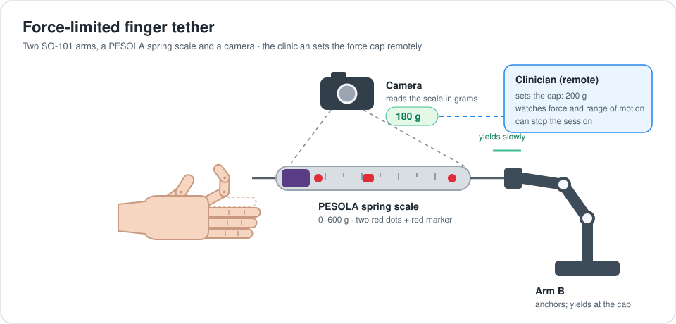
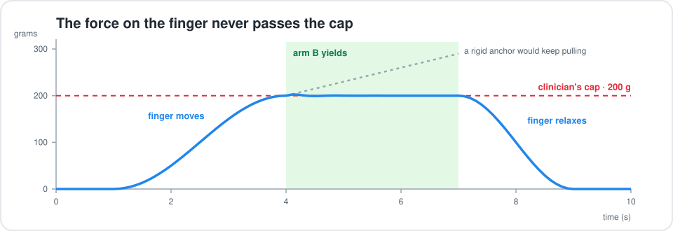
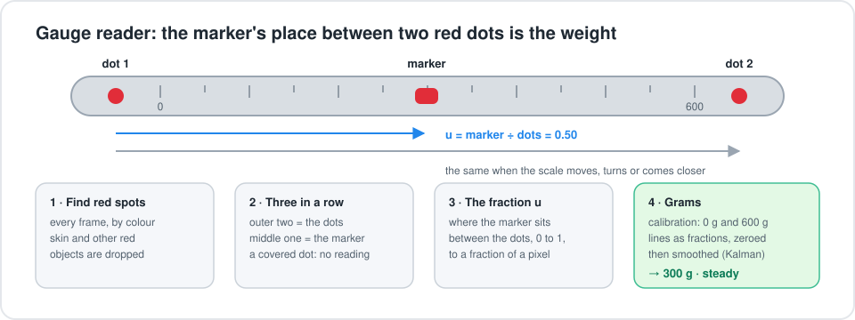

<div align="center">


# Force-Limited Finger Tether

**Robot-assisted finger rehabilitation after hand surgery, with a force cap the clinician sets remotely.**<br>
By team **Flex'N Sense** at the Leukerbad Robotics Hackathon 2026.

[](https://luma.com/event/evt-7RecqicPQUegOIG)
[](#the-hackathon)
[](./docs/elrobot.md)
[](./SETUP.md)
[](./gauge_reader)
[](./tests)
[](#status)



</div>

## Contents

- [The hackathon](#the-hackathon)
- [Team](#team)
- [The problem](#the-problem)
- [Our solution](#our-solution)
- [How it works](#how-it-works)
- [Status](#status)
- [Getting started](#getting-started)
- [Repository layout](#repository-layout)
- [Documentation and contributing](#documentation-and-contributing)
- [Acknowledgements](#acknowledgements)

## The hackathon

- **Event:** [Leukerbad Robotics Hackathon 2026](https://luma.com/event/evt-7RecqicPQUegOIG) (Robotics, XR and AI)
- **When:** 14–16 November 2026
- **Where:** Sportarena Leukerbad, Valais, Switzerland
- **Challenge:** Elderly Care & Rehabilitation, one of four alongside Autonomous Urban Services, Resilient & Safe City and Sustainable City
- **Our hardware:** two NormaCore ElRobot arms (7 joints + gripper, 8x Feetech ST3215), a PESOLA 600 g spring scale and a camera

## Team

We are **Flex'N Sense**, a team of six.

| Name | Background | GitHub |
|---|---|---|
| Guillaume Bonifas | Robotics & MedTech, scale-up leader | [@Guitool77](https://github.com/Guitool77) |
| Damien Frechou | Mechatronics, automation & control systems | |
| Ana Tissera | AI Engineering, Universidad de San Andrés | [@anatissera](https://github.com/anatissera) |
| Laurence Liang | Applied AI Engineer at Mistral. Rootly (YC S21) AI Labs, Groq, MDA Space | [@TheFloatingString](https://github.com/TheFloatingString) |
| Javier Peres | AI Engineer | [@peresramirez](https://github.com/peresramirez) |
| Justo Valverde | Robotics Software Engineering student, URJC | |

## The problem

After hand surgery, fingers have to be moved early and regularly to prevent tendons and joint capsules from sticking (adhesions). This is the job of **CPM, continuous passive motion**. The force matters: dynamic finger splints in hand therapy work in the **0–450 g (0–4.4 N)** range, and too much force on a healing finger does harm. Therapists cannot be present for every session, and the kit available here has **no force sensor**.

## Our solution

A **force-limited tether** built from two ElRobot arms, with a clinician supervising remotely:

1. **Arm A** holds the patient's hand still in a fixed pose (a hard-coded position, no policy).
2. **Arm B** is tied to one finger through a **PESOLA spring scale** (0–600 g, 5 g per line, a red indicator on a linear printed scale).
3. The patient moves the finger. Arm B stays put as an anchor, so the spring stretches and the force rises.
4. When the force reaches the patient's prescribed cap (e.g. **200 g, 1.96 N**), arm B **yields**: it moves slowly with the finger so the spring stretches no further.
5. The **clinician** sets the cap and watches the session remotely, and can stop it.

### The bench as it actually is


Two leader/follower pairs. **Follower 1** carries the tether and runs the admittance controller; **Follower 2** moves the hook from one finger to the next and is being trained separately. The leaders are for teleoperation and for recording demonstrations, not for a running session. Bus serials and roles: [docs/hardware-setup.md](./docs/hardware-setup.md).

Worth noting against step 1 above: in the rig as built **no arm holds the hand**, it rests on the work surface. That matters because every pose-dependent number is measured against whatever pose the hand is in, so it is worth settling before those measurements are taken. The detail is in [docs/hardware-setup.md](./docs/hardware-setup.md).



## How it works

### Measuring force without a force sensor

Two independent signals:

| Signal | How | Strength | Weakness |
|---|---|---|---|
| **Camera + PESOLA** | Read the red indicator against the printed scale and convert its position to grams (the gauge reader) | Physical ground truth, ~30 Hz | Glare, occlusion, motion blur |
| **Servo current** | ST3215 current, read from NormaCore Station's `st3215/inference` queue, in mA already decoded | Fast and robust | Unitless; gearbox friction |

The arm is the **NormaCore ElRobot**, not an SO-101: same servo family (Feetech ST3215), so the force path below is unchanged in kind, but there is no LeRobot support for this arm - everything goes through NormaCore's own software, Station, instead. What that means in practice: [docs/elrobot.md](./docs/elrobot.md).

The plan was to calibrate servo current against the camera and run the control loop on current for speed. **Run against real hardware, result negative**: the 345:1 gearbox leaves no usable current signal, just a ~1 mA noise floor regardless of applied force - see [docs/force-calibration-result.md](./docs/force-calibration-result.md). Force sensing is entirely on the camera; the control loop runs at the camera's rate, and a lost or low-confidence reading has no fallback signal to fall back on, only the "release and stop" behaviour in Safety below.

**Gauge reader.** Two red dots drawn on the PESOLA's tube act as fixed references. Each frame, the camera finds the three red spots in a row (dot, marker, dot); the marker's position *between* the dots is a fraction that does not change when the scale moves, turns or comes closer, and calibration turns it into grams. When a dot is covered, it reports a reason instead of a number. Details: [docs/scale-reader.md](./docs/scale-reader.md).



### Control

Admittance control with a deadband, clinically *assist-as-needed*. The gauge reads grams, matching the PESOLA and the clinician's cap, but everything past that reading is in newtons (SI), see AGENTS.md "Units":

```python
F = read_force()                            # newtons, from the camera; None if the marker was not seen
F_threshold = grams_force_to_newtons(200)   # the clinician's cap is set in grams, 200 gf = 1.96 N
if F is None or F > F_max or stale:
    release_and_stop()          # never guess a force, never hold tension blind
elif F <= F_threshold:
    hold_position()             # the arm is the anchor
else:
    v = min((F - F_threshold) / B, v_max)   # yield proportionally to the excess
    move(v * dt, direction_that_reduces_F)  # dt from real frame timestamps
```

Implemented in `control/`: the gate (`safety.py`), the law (`admittance.py`), the wiring to camera and Station (`loop.py`), and a closed-loop simulation for choosing constants (`simulate.py`). The simulation established that the damping `B` is bounded by the gap between the cap and the ceiling (overshoot settles at `B x pull speed`), and that a fast yank is handled by the gate releasing rather than by the loop tracking it: [docs/admittance-design.md](./docs/admittance-design.md).

This is deliberately **not** a learned policy. ACT and Diffusion Policy execute action chunks open-loop and cannot react to contact forces mid-chunk, the exact failure a device pulling on a post-surgical finger must not have. They also need 50–200 demonstrations and ~16 GB of VRAM, against a 4 GB laptop GPU and two days. RL from scratch is out for the same reason.

### Safety

Force limits on the patient are enforced **independently of the main control loop**:

- a torque/current cap written to the servo registers, in force even if the control process dies;
- software position limits on how far arm B can travel;
- a vision watchdog: on lost detection, low confidence or dropped frames, **release tension and stop**, never hold;
- low maximum velocity throughout;
- a physical e-stop within reach of the patient and the operator;
- the spring itself acts as a mechanical fuse.

### Where the learning is

- The **vision model** that reads the PESOLA scale.
- **Hand keypoint tracking** to measure the finger's range of motion: MediaPipe live, WiLoR for precision capture (it adds MANO joint rotations). Both emit the same `HandFrame`, see [docs/hand-tracking.md](./docs/hand-tracking.md).
- **Per-patient cap adaptation** from the patient's response within a session: a lightweight online estimator, not deep RL.
- The **force–displacement curve** across the session, which yields joint stiffness, a published biomarker of post-surgical tendon adhesion. The device measures recovery, not only exercises it; this is what the clinician watches evolve between sessions.
- **Re-hooking the dynamometer between fingers**, on the second arm pair, is a separate manipulation task trained with imitation learning (teleoperated demonstrations, behaviour cloning), not the admittance controller. See [docs/hardware-setup.md](./docs/hardware-setup.md) for which physical arm is which.

## Status

The work is split into the subtasks of [ROADMAP.md](./ROADMAP.md), one branch and one PR each.

| # | Subtask | Branch | Status |
|---|---|---|---|
| 1 | Force calibration: can servo current stand in for a force sensor? | `feature/force-calibration` | ❌ answered: no ([docs/force-calibration-result.md](./docs/force-calibration-result.md)) |
| 2 | Gauge reader: PESOLA → grams + confidence from a camera | `feature/gauge-reader` | ✅ merged ([#5](https://github.com/anatissera/leukerbad-hackathon/pull/5)) |
| 3 | Admittance controller + safety layer | `feature/admittance-control` | 🟡 written, not yet on hardware |
| 4 | Simulation rig (MuJoCo + spring) | `feature/sim-rig` | ⚪ planned |
| 5 | Hand tracking / range of motion | `feature/hand-tracking` | ✅ merged ([#16](https://github.com/anatissera/leukerbad-hackathon/pull/16)) |
| 6 | Session metrics: force–displacement, stiffness | `feature/session-metrics` | ⚪ planned |
| 7 | Remote clinician dashboard | `feature/remote-dashboard` | ⚪ planned |
| - | ElRobot (NormaCore Station) instead of LeRobot: the arm we actually have | `feature/elrobot-support` | 🟡 in progress ([#17](https://github.com/anatissera/leukerbad-hackathon/pull/17)) |

## Getting started

```bash
git clone https://github.com/anatissera/leukerbad-hackathon.git && cd leukerbad-hackathon
uv venv --python 3.12 .venv && uv pip install --python .venv/bin/python -r requirements.txt
.venv/bin/python -m pytest -q                   # all tests, no camera, robot or Station needed
.venv/bin/python -m gauge_reader.launcher      # gauge reader control panel: camera, calibrate, run
.venv/bin/python -m gauge_reader.server        # live force for the dashboard (ws://127.0.0.1:8766/force)
.venv/bin/python -m hand_tracking run           # finger flexion angles, live window (downloads the model once)
.venv/bin/python -m hand_tracking run --jsonl frames.jsonl   # + the full per-frame HandFrame
```

Arm (NormaCore Station, motor ids, calibration, `.env`): [SETUP.md](./SETUP.md). There is no
LeRobot support for the ElRobot - see [docs/elrobot.md](./docs/elrobot.md) before assuming
otherwise.

## Repository layout

```
lib/              shared helpers for any script: camera, .env settings, Kalman filter, geometry, Station client
gauge_reader/     subtask 2: read the PESOLA scale through a camera (python -m gauge_reader)
hand_tracking/    subtask 5: finger flexion angles through a camera (python -m hand_tracking)
control/          subtask 3: the admittance controller, its safety gate and a simulation
session/          subtask 5b: exercise modes, the prescription, the session and rep machines, the two-arm interlock
scripts/          robot and calibration scripts, against Station (force calibration, bench measurements)
scripts/lerobot/  NOT our hardware: the original SO-101-via-LeRobot scripts, parked in case we ever port
tests/            tests per package: tests/lib/, tests/gauge_reader/, tests/hand_tracking/
docs/             guides and diagrams
```

Reusable code goes in `lib/`, for example:

```python
from lib.camera import open_source       # cameras by number or name ("iphone"), or video files
from lib.filters import ReadingFilter    # smooth any noisy signal, with a "steady" flag

src, filt = open_source(camera="iphone"), ReadingFilter()
ok, frame, ts, idx = src.read()
```

## Documentation and contributing

| Document | What it covers |
|---|---|
| [ROADMAP.md](./ROADMAP.md) | The subtasks, their order and branches |
| [SETUP.md](./SETUP.md) | Python, Station, motors and `.env` |
| [docs/elrobot.md](./docs/elrobot.md) | The ElRobot and NormaCore Station: why not LeRobot, the real client, what's unverified |
| [docs/bench-measurements.md](./docs/bench-measurements.md) | **How to take the bench measurements**: tether stiffness, fingertip excursion, ticks per metre |
| [docs/force-calibration.md](./docs/force-calibration.md) | The servo-current calibration experiment |
| [docs/scale-reader.md](./docs/scale-reader.md) | The gauge reader: setup, calibration, precision, troubleshooting |
| [docs/hand-tracking.md](./docs/hand-tracking.md) | Hand landmarks: model, the flexion angle, running it |
| [docs/hardware-setup.md](./docs/hardware-setup.md) | Which physical arm is which: Follower 1/2, Leader 1/2, bus serials, who runs what |
| [docs/session-orchestration.md](./docs/session-orchestration.md) | The two exercise modes, the rep and session state machines, the two-arm interlock, why arm 1 needs no VLA |
| [docs/pull-mode-design.md](./docs/pull-mode-design.md) | Passive (device-driven) mode: the inverted monotonicity guard, the three stop conditions, end-feel. Designed, not implemented |
| [docs/pitch-v6-storytelling/](./docs/pitch-v6-storytelling/) | Pitch deck (HTML), current version: version 5 with a 25-second intro film in front, which starts on one key press and moves to the first slide when it ends (open `index.html` locally). The words to say over the film are in `INTRO-SCRIPT.md`. |
| [docs/pitch-v5-storytelling/](./docs/pitch-v5-storytelling/) | Pitch deck (HTML): the pitch told as one patient's story in four acts, with real footage (open `index.html` locally). The original PowerPoint is [docs/Pitch.pptx](./docs/Pitch.pptx) |
| [AGENTS.md](./AGENTS.md) | Git workflow, branch naming, rules for contributors and coding agents |

`main` is protected: work on the roadmap branch and open a PR. Commits and PRs do not credit AI tools (see [AGENTS.md](./AGENTS.md)).

## Dashboard (Next.js app)

A browser dashboard in `dashboard/`: a 3D MyoHand (MuJoCo, in the browser) with a finger-curl stress test, recovery metrics and charts, and a text/voice assistant (OpenAI) that answers from the simulated results. All data is simulated.

```bash
cd dashboard
pnpm install                    # Node 20+, pnpm 9
cp .env.example .env            # then set OPENAI_API_KEY in .env
pnpm dev                        # http://localhost:3000
```

- `OPENAI_API_KEY` is read server-side only (`dashboard/app/api/chat`, `dashboard/app/api/realtime`); the browser never sees it. Without it the simulator still runs, but the chat and voice panel return an error.
- Optional overrides in `dashboard/.env`: `OPENAI_MODEL` (chat) and `OPENAI_REALTIME_MODEL` (voice).
- The MyoHand model files are served from `dashboard/public/models/myohand`.
- Voice needs microphone permission and network access to `api.openai.com`.
- (from `dashboard/`) `pnpm build && pnpm start` runs the production build; `pnpm lint` runs ESLint.

## Where to start
## Acknowledgements

Built at the Leukerbad Robotics Hackathon 2026, co-organized by the Edelweiss Innovation & Intelligence Institute (EIII), HerCode, AI Team, EuroTech Federation and TUM-XR. Thanks to the organizers, mentors and hardware partners.
