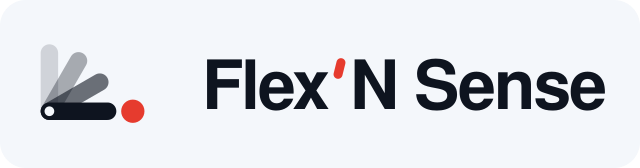
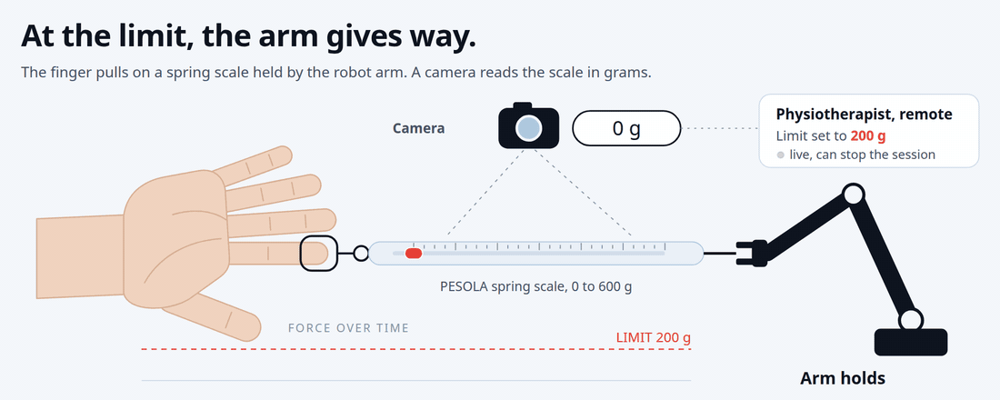
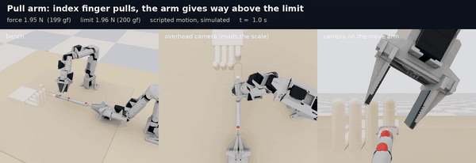
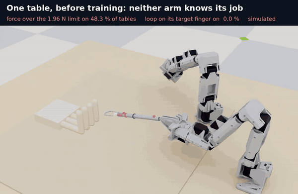
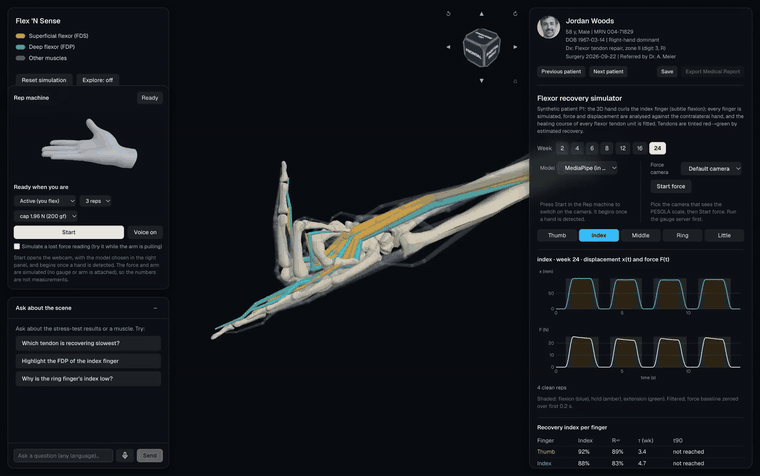

<div align="center">



# Force-Limited Hand Rehabilitation

**Two robot arms move a patient's finger against a force cap a clinician sets remotely.**<br>
For recovery after surgery, injury, stroke, or age-related loss of hand strength.

[](./docs/elrobot.md)
[](./SETUP.md)
[](./tests)
[](./LICENSE)

</div>



The arm is the anchor, not the mover. The patient pulls, a camera reads the force off a PESOLA
spring scale thirty times a second, and when the reading reaches the prescribed cap the arm
**gives way**: it retreats just fast enough that the spring stretches no further. The force the
finger feels is therefore bounded by the control law, not by how hard the patient pulls.

## Why this is hard

A healing finger tolerates very little. Dynamic finger splints in hand therapy work in the
**0 to 450 gf (0 to 4.4 N)** range, and past that you are not treating a tendon, you are
damaging one. So the force has to be known continuously and bounded by something that keeps
working when the software does not.

The kit has **no force sensor**. The obvious substitute, servo current, was measured and ruled
out: the 345:1 gearbox leaves a ~1 mA noise floor regardless of applied force
([docs/force-calibration-result.md](./docs/force-calibration-result.md)). That negative result
is why force sensing is entirely on the camera, and why a lost or low-confidence frame has no
fallback to fall back on, only "release and stop".

This is deliberately **not** a learned policy on the arm that touches the patient. ACT and
Diffusion Policy execute action chunks open-loop and cannot react to contact forces mid-chunk,
which is the exact failure a device pulling on a post-surgical finger must not have.

## How it works

### Reading force from a camera

Two red dots on the PESOLA's tube are fixed references. Each frame the reader finds three red
spots in a row (dot, marker, dot); the marker's position *between* the dots is a fraction that
does not change when the scale moves, turns, or comes closer, and calibration turns that
fraction into grams. When a dot is covered it reports a reason instead of a number.


Details, calibration and failure modes: [docs/scale-reader.md](./docs/scale-reader.md).

### The control law

Admittance control with a deadband, clinically *assist-as-needed*. The gauge reads grams, which
is what the PESOLA is graduated in and what the clinician sets; everything past that reading is
in newtons:

```python
F = read_force()                            # newtons, from the camera; None if the marker was not seen
F_threshold = grams_force_to_newtons(200)   # the clinician's cap, set in grams
if F is None or F > F_max or stale:
    release_and_stop()          # never guess a force, never hold tension blind
elif F <= F_threshold:
    hold_position()             # the arm is the anchor
else:
    v = min((F - F_threshold) / B, v_max)   # yield proportionally to the excess
    move(v * dt, direction_that_reduces_F)  # dt from real frame timestamps
```

`arm1/control/safety.py` is the gate (HOLD / YIELD / RELEASE), `arm1/control/admittance.py` the law,
`arm1/control/loop.py` the only part that touches hardware. The first two are pure and exhaustively
tested. Why `B` is bounded by the gap between cap and ceiling:
[docs/admittance-design.md](./docs/admittance-design.md).

### Three joints, not one

A revolute joint moves the gripper along an **arc**, and the tether does not bend, so whatever
leaves the line becomes side-load on the finger or slack in the tether. One full-range
repetition needs 72 to 88 mm of travel. Asked for 90 mm along the tether from the saved home
pose, no single joint can deliver it:

| Joints | Distance covered | Deviation from the line |
|---|---|---|
| Best single joint (motor 4) | 21.8 mm of 90 | 38.1 mm |
| Motors 1, 2 and 4 together | 89.9 mm of 90 | 0.9 mm |

The joints with low deviation in isolation (5 and 6) score that way because they barely move
along the tether at all. Coordination is not a refinement here, it is what makes the stroke
possible.

Two joints are not enough either: their jacobian is rank 2, so the reachable directions form a
plane, and the stroke that is not in it misses. `CoordinatedAxis` refuses fewer than three, and
refuses a pose that cannot follow the pull to the end.

Measured from NormaCore's URDF at the saved home pose, no simulator and no bench needed.
`.venv/bin/python scripts/arm/which_motor.py` runs the same geometry against the live pose.

### Two exercise modes

| Mode | Work beat | Reset beat |
|---|---|---|
| `active` | the patient flexes, the arm yields at the cap | the arm walks back to where the rep began |
| `cpm` | the arm takes the finger out to the stretch target | the arm brings it back; the patient is passive throughout |

`cpm` is the only mode where the driver does not flip within a repetition, which is the point of
it: a repetition that waits on nobody is the same motion every time, so it can run faster and
more smoothly than an arm chasing a signal. It also means a lost force reading stops *both*
halves of the stroke, not one.

Both modes count honestly. A repetition is counted only once the force actually reached the cap,
so a patient who moved a little and came back shows as an **abandoned attempt**, not a rep.

### Safety

Force limits on the patient are enforced **independently of the control loop**:

- a current cap written to the servo registers by Station's own `station.yaml`, in force even if
  every Python process dies;
- software position limits on total travel;
- a vision watchdog: on lost detection, low confidence or dropped frames, **release and stop**,
  never hold;
- a per-cycle deadman on any phase where the arm moves the finger: one missing frame stops the
  advance;
- a low velocity ceiling throughout, and a physical e-stop within reach;
- the spring itself as a mechanical fuse.

**A missing force reading is never evidence of a safe force.** That single rule is why the gate
refuses to guess, why the deadman stops a blind pull, and why the two-machine lease expires on
silence rather than persisting.

## The two arms are trained completely differently

This is the part worth understanding, because the two arms sit at opposite ends of the
"learned versus specified" question, on purpose.

### Arm 1, the tether: no learning at all

Fixed control law, hand-tuned constants, exhaustively tested gate. Nothing about it is learned,
because the thing it does (bound a force on a healing finger) is a specification, not a pattern
to be inferred from data. The constants live in
[`config/session-tuning.json`](./config/session-tuning.json), each one annotated in
[`arm1/session/tuning.py`](./arm1/session/tuning.py) with the bench failure it is paying for.

### Arm 2, the hook mover: behaviour cloning from teleoperation

Moving the scale's hook from one finger to the next is fiddly, contact-rich, and has no clean
analytic solution. So it is learned, from demonstrations:

1. **Record.** A human teleoperates arm 2 through the move with a leader arm, while Station
   records joints and three cameras. [`arm2/data_collection/`](./arm2/data_collection/)
2. **Augment.** WiLoR runs on the side camera and writes 21 hand keypoints into every frame, so
   the policy sees where the fingers actually are, not just where the arm is.
3. **Train.** ACT on the resulting LeRobot dataset, one multi-task model covering all three
   finger-to-finger moves, selected by a `--task` phrase.
   [`arm2/training/`](./arm2/training/)
4. **Run.** The policy drives the arm through Station, with its own goal-rate limits, abort rule
   and stalled-motor hold. It does **not** implement this project's safety layer and must not be
   used near a patient's hand.

**226 teleoperated episodes**, publicly available:
[JustoDario/flexnsense_skill1](https://huggingface.co/datasets/JustoDario/flexnsense_skill1).

A policy cannot confirm its own success, so it never reports one. A person watching the arm
presses a button, `stop_and_home.py` stops the policy and homes the arm, and its **exit code**
decides what the session is told. That is the whole reason `PolicyHookMover` raises instead of
returning a plausible outcome: a hook reported as moved when it has not moved means arm 1 starts
pulling on a finger the hook is not attached to.

### Both arms in simulation

The bench is rebuilt in NVIDIA Isaac Sim, with the scale as a real physical object rather than
a scripted constraint, and both arms are trained together in Isaac Lab across thousands of
tables at once. **Simulation only**: none of these policies has moved the real arm.
[`isaac-sim/`](./isaac-sim/)



The force on the frame is the simulator's own, so it shows directly whether a policy stayed
under the 1.96 N limit, which a video of the arm alone cannot.



Before training, 47.6% of tables are over the force limit and none has the loop on its target
finger. Those two numbers are the reward, and watching them is how a training run is judged.

## Running a session

One block, on one finger, against the real arm:

```bash
.venv/bin/python scripts/session/run_session.py --finger index --cap-gf 150 --reps 3
```

No tuning flags: the bench-proven profile in `config/session-tuning.json` supplies them, and the
banner prints the gate's limits on every run. From a clinician's prescription instead:

```bash
.venv/bin/python scripts/session/run_session.py --protocol config/protocols/tendon-repair-active.json
```

Continuous passive motion, which walks between two saved poses rather than chasing a force:

```bash
.venv/bin/python scripts/session/run_cpm.py --no-camera --reps 1   # check the path, nothing attached
.venv/bin/python scripts/session/run_cpm.py --reps 3               # with the finger hooked
```

### Across two machines

Arm 2 and its cameras run on one computer, arm 1 and the force camera on another. **Arm 1's
machine is the brain**, and that is not a preference: every safety decision is a function of the
force reading, so putting the brain on the machine that owns the force camera keeps all of them
off the network.

```bash
# on arm 2's machine
.venv/bin/python -m arm1.session.link serve --host 0.0.0.0 --port 8770

# on arm 1's machine, one request over the real socket
.venv/bin/python scripts/session/try_remote_hook.py --url ws://<arm2-host>:8770/arm2 --finger index
```

Custody is a **lease with a deadline**, not a flag. A flag set by "you may move" stays set when
the link dies and the far arm keeps going with nobody able to stop it; a lease has to be renewed,
so silence means stop. Four message types, no shell commands, and why:
[docs/two-machine-session.md](./docs/two-machine-session.md).

## The dashboard

```bash
cd dashboard && pnpm install
pnpm dev                        # bench build: probes 127.0.0.1 for the gauge and tracker
NEXT_PUBLIC_DEMO=1 pnpm dev     # demonstration build: nothing attached, and it says so
```



A 3D MyoHand in MuJoCo WebAssembly with the flexor tendons tinted by estimated recovery, hand
tracking on the laptop camera, the repetition machine, and a text/voice assistant that answers
from the results. `NEXT_PUBLIC_DEMO` is the only
difference between the public build and the one that runs beside the rig: with it set nothing is
probed, and every panel carries a badge saying where its numbers come from.

When a real session is running, `python -m arm1.session.snapshot_server` streams it and the panel
shows the arm instead of the simulation, badged `live session`.
[docs/dashboard-demo.md](./docs/dashboard-demo.md)

## What has and has not touched a patient

Nothing here has touched a patient. Against the **bench**, with a finger in the hook:

| | |
|---|---|
| Admittance control, `active` mode | runs, full sets completed on the real arm |
| Coordinated three-joint pull | runs |
| Gauge reader | runs, with a known intermittent fault (below) |
| `cpm` mode | implemented and tested in software, **has not moved a real finger** |
| Two-machine handover | protocol verified over a real socket, **never run with both arms powered** |
| Arm 2 policies | one ACT ran on the arm with a mediocre result; the newer ones are untested on it |
| Isaac Lab policies | simulation only |

**Known fault:** the gauge reader occasionally swaps the two reference stickers, which inverts
the whole scale (`g` reads as `570 - g`) and stays inverted until tracking breaks. Diagnosed to
the orientation tiebreak in `arm1/gauge_reader/stickers.py`; the profile that is supposed to tell the
two ends apart scores both orientations identically on this rig. Not yet fixed.

## Setup

```bash
git clone https://github.com/anatissera/flexnsense.git && cd flexnsense
uv venv --python 3.12 .venv && uv pip install --python .venv/bin/python -r requirements.txt
.venv/bin/python -m pytest -q          # 1168 tests, no camera, robot or Station needed
```

Everything runs without hardware. The arm, Station, motor ids and `.env`: [SETUP.md](./SETUP.md).
There is **no LeRobot support for the ElRobot**, so every path to the arm goes through
NormaCore's Station: [docs/elrobot.md](./docs/elrobot.md).

```bash
.venv/bin/python -m arm1.gauge_reader.launcher     # camera, calibrate, run
.venv/bin/python -m arm1.gauge_reader.server       # live force for the dashboard
.venv/bin/python -m arm1.hand_tracking run         # finger flexion angles
```

## Repository layout

```
arm1/             the tether arm: inverse kinematics and a fixed control law, nothing learned
  lib/            shared helpers, no device knowledge: camera, .env, Kalman filter, geometry, kinematics, Station client
  control/        the admittance controller: safety gate, the law, the hardware loop, simulation
  session/        prescriptions, exercise modes, the rep machine, the interlock, the two-machine protocol
  gauge_reader/   read the PESOLA scale through a camera
  hand_tracking/  finger flexion angles (MediaPipe on CPU, WiLoR for precision capture)
arm2/             the hook mover: teleoperated recordings and the policy trained on them
  data_collection/  record episodes through Station, with hand keypoints in every frame
  training/         Station Parquet to LeRobot, ACT training, inference on the arm
scripts/          grouped by what they do to the rig (scripts/README.md)
  session/        run an exercise with a finger in the hook
  arm/            move or configure the arm, nothing attached
  measure/        produce a number the repo then depends on
  preview/        render or inspect, nothing moves
config/           committed: joint calibration, bench measurements, tuning profile, example protocols
dashboard/        the Next.js clinician dashboard (own package.json)
isaac-sim/        both arms in Isaac Sim and Isaac Lab (simulation only)
sim/              URDF-level checks that need no simulator
tests/            one directory per package above
docs/             guides, design documents, the contributor guide and the pitch deck
```

`arm1/` and `arm2/` is the division the two halves of this project actually have: the tether
arm is solved with inverse kinematics and a control law nobody trained, and the hook mover is a
policy cloned from teleoperation. They share `lib/` and Station, and nothing else.


## Configuration, and which machine holds what

| File | Holds | Committed |
|---|---|---|
| `config/session-tuning.json` | the machine's own tuning: damping, speeds, camera gating | yes, it describes the shared rig |
| `config/protocols/*.json` | a clinician's prescription: finger, mode, reps, cap, hold | yes, it is shared clinical intent |
| `config/calibration/*.json` | joint ranges, home poses, bench constants | yes, measured not chosen |
| `config/scale_calib.json` | where *this* camera sees the scale | no, per machine |
| `.env` | Station host, bus serials, camera index | no, per machine |

The dividing question for tuning versus prescription is "would a different patient change this
number?" If yes it is a prescription, if no it is tuning.

Three values in the tuning profile are deliberately **looser** than what the code shipped with:
the hard ceiling, the blind-frame count, and the yield-direction check being off. They sit in
their own `safety` block and are printed on every run, because a loosened limit nobody is shown
on the way past stops being a decision and becomes an accident.

Which physical arm is which, bus serials, voltages:
[docs/hardware-setup.md](./docs/hardware-setup.md).

## Models and data

| Repo | What it holds |
|---|---|
| [JustoDario/flexnsense_skill1](https://huggingface.co/datasets/JustoDario/flexnsense_skill1) | 226 teleoperated episodes on the real arm 2: three finger-to-finger tasks, three cameras, hand keypoints per frame |
| [JustoDario/flexnsense_act_skill1_rightindex2middle](https://huggingface.co/JustoDario/flexnsense_act_skill1_rightindex2middle) | The first ACT policy, the one that ran on the arm |
| [JustoDario/flexnsense_smolvla](https://huggingface.co/JustoDario/flexnsense_smolvla) | SmolVLA fine-tuned on the same episodes. Untested on the arm |
| [peresjav/flexnsense-sim-policies](https://huggingface.co/peresjav/flexnsense-sim-policies) | The Isaac Lab policies, training code and videos. Simulation only |
| [peresjav/lerobot-2026](https://huggingface.co/datasets/peresjav/lerobot-2026) | 512 simulated episodes per policy, Parquet, no images |

## Documentation

| Document | Covers |
|---|---|
| [SETUP.md](./SETUP.md) | Python, Station, motors, `.env` |
| [docs/elrobot.md](./docs/elrobot.md) | The arm and Station: why not LeRobot, what is verified |
| [docs/hardware-setup.md](./docs/hardware-setup.md) | Which arm is which, bus serials, who runs what |
| [docs/bench-measurements.md](./docs/bench-measurements.md) | How to take every bench number this repo depends on |
| [docs/admittance-design.md](./docs/admittance-design.md) | The control law, choosing `B`, what the simulation established |
| [docs/session-orchestration.md](./docs/session-orchestration.md) | Modes, the rep machine, the two-arm interlock |
| [docs/two-machine-session.md](./docs/two-machine-session.md) | The socket protocol, the lease, the four rules a network must not break |
| [docs/scale-reader.md](./docs/scale-reader.md) | The gauge reader: calibration, precision, troubleshooting |
| [docs/hand-tracking.md](./docs/hand-tracking.md) | MediaPipe and WiLoR, the flexion angle, the VRAM question |
| [docs/force-calibration-result.md](./docs/force-calibration-result.md) | Why servo current cannot stand in for a force sensor |
| [docs/dashboard-demo.md](./docs/dashboard-demo.md) | The two dashboard builds, what is real in each |
| [docs/contributing.md](./docs/contributing.md) | Git workflow, units, rules for contributors and coding agents |

`main` is protected: work on a branch and open a PR.

## Licences

This repository is MIT ([LICENSE](./LICENSE)). The pieces it builds on are not all as
permissive, and two of them matter for anything beyond research:

| Component | Licence | What it means here |
|---|---|---|
| NormaCore Station and the ElRobot URDF | MIT | no constraint |
| LeRobot | Apache 2.0 | no constraint |
| MediaPipe, OpenCV, NumPy | Apache 2.0 / BSD | no constraint |
| MuJoCo (dashboard, WebAssembly) | Apache 2.0 | no constraint |
| **WiLoR** | **CC BY-NC-ND 4.0** | **non-commercial, no derivatives.** Used for hand keypoints in arm 2's training data and as the dashboard's precision tracker |
| **MANO** (WiLoR depends on it) | own licence, registration required | separate terms, must be accepted directly |

**A commercial product could not ship WiLoR or MANO as they stand.** MediaPipe, which is the
dashboard's default tracker and Apache 2.0, is the path that does not have this problem. This is
worth settling before any of this leaves research.

## Team

Flex'N Sense, built at the Leukerbad Robotics Hackathon 2026 (Elderly Care & Rehabilitation
track).

| | | |
|---|---|---|
| Guillaume Bonifas | Robotics & MedTech | [@Guitool77](https://github.com/Guitool77) |
| Damien Frechou | Mechatronics, control systems | |
| Ana Tissera | AI Engineering, Universidad de San Andrés | [@anatissera](https://github.com/anatissera) |
| Laurence Liang | Applied AI, Mistral | [@TheFloatingString](https://github.com/TheFloatingString) |
| Javier Peres | AI Engineering | [@peresramirez](https://github.com/peresramirez) |
| Justo Valverde | Robotics Software Engineering, URJC | |

Thanks to the organizers at the Edelweiss Innovation & Intelligence Institute, HerCode, AI Team,
EuroTech Federation and TUM-XR, and to the hardware partners.
